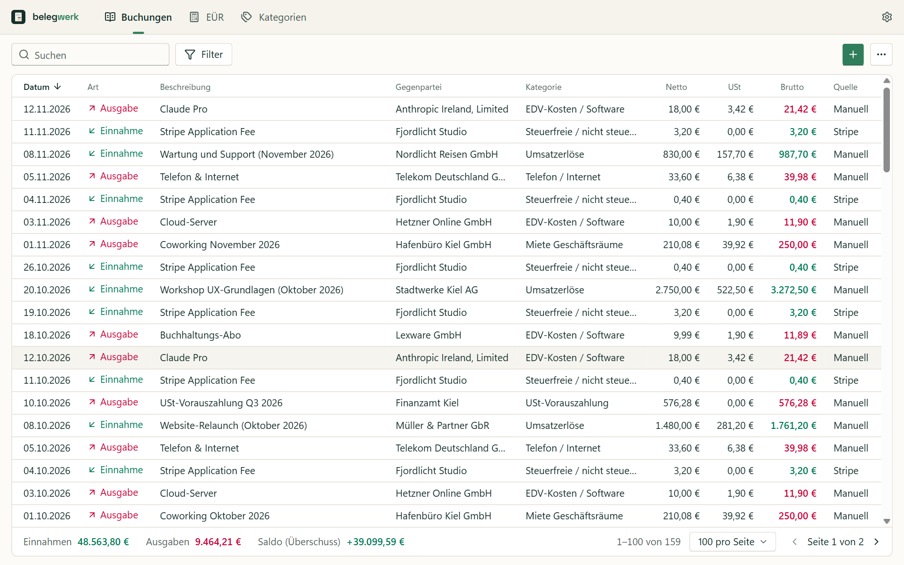

> [!WARNING]
> **100 % vibe-coded – Nutzung auf eigene Gefahr.**

  <picture>
    <source media="(prefers-color-scheme: dark)" srcset="docs/logo-dark.svg">
    
  </picture>

Belegwerk ist eine Windows-App, mit der Selbstständige Einnahmen und Ausgaben
erfassen und die Einnahmenüberschussrechnung (Anlage EÜR) erstellen. Alle Daten
bleiben auf dem eigenen Rechner.

## Funktionen

- Buchungen erfassen; Netto und Umsatzsteuer werden aus dem Brutto berechnet
- Buchungen suchen, filtern, sortieren und summieren
- EÜR pro Jahr mit den Zeilennummern der Anlage EÜR (2025 und 2026)
- Regelbesteuerung oder Kleinunternehmer (§ 19 UStG), pro Jahr einstellbar
- Eigene Kategorien mit Zuordnung zur EÜR
- Import von Stripe Application Fees und deren Rückerstattungen
- CSV-Export von Buchungen und EÜR
- Backup der gesamten Daten

## Installation

Die aktuelle Version unter
[Releases](https://github.com/patrick-b6n/belegwerk/releases) herunterladen
und starten. Eine Installation ist nicht nötig. Weitere Hinweise stehen im
[Handbuch](docs/handbuch.md).

## Development

See [docs/development.md](docs/development.md).
