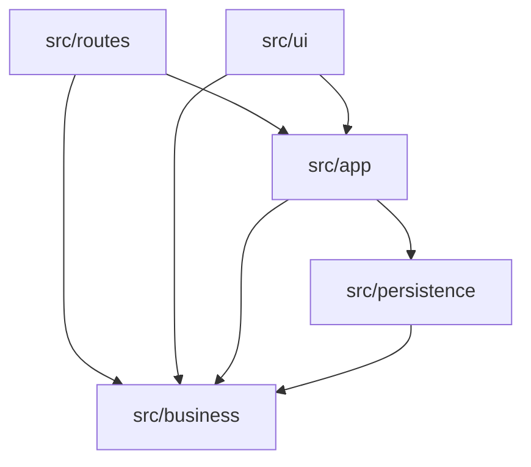

# Architecture

Belegwerk is a Tauri v2 desktop app. The logic runs in TypeScript inside the
WebView; Rust only hosts it (window, SQLite, file dialogs, HTTP) and handles
the auto-update.

**Stack:** React, TanStack Start (SPA mode) with Router, Query, Table and Form,
shadcn/ui, Tailwind, SQLite with Drizzle ORM, Paraglide JS (German only).

## Layers

Arrows = "imports from". oxlint enforces the boundaries.

| Layer             | Contents                                                       |
| ----------------- | -------------------------------------------------------------- |
| `src/routes`      | Thin file-based routes                                         |
| `src/ui`          | Components and styles                                          |
| `src/business`    | Domain logic, services, repository interfaces; no React/Tauri  |
| `src/persistence` | Drizzle schema, migrations, repository implementations         |
| `src/app`         | Composition root: opens the DB, creates services, Tauri access |

## Conventions

- UI and routes use services only, never repositories.
- Each service operation runs its database access in one `UnitOfWork.run`.
  Inside the callback, use only the repositories passed in: there is a single
  database connection, so anything else deadlocks.
- Services return result objects with error codes; programming errors throw.
  The UI translates the codes.
